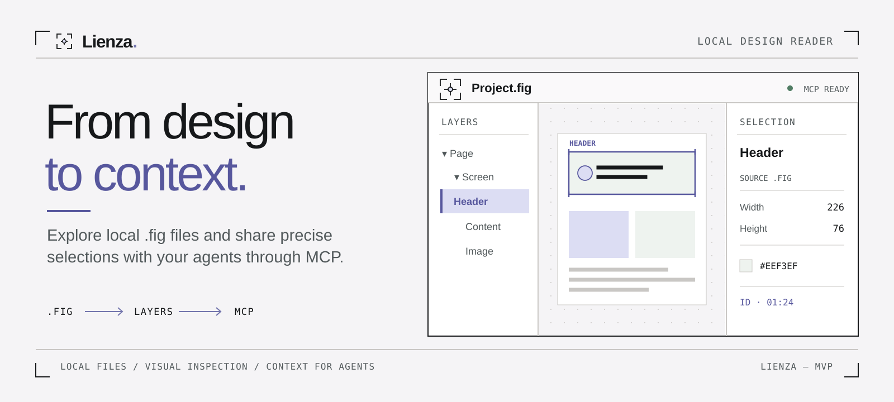

# Lienza — Local Figma Reader and MCP Server



Lienza opens local `.fig` files so you can inspect pages, select layers, and share precise design context with AI agents such as Codex and Claude. It reads the file on your machine without using the official Figma API.

The viewer supports English and Spanish. Its language switcher is available in the project library, reader, and theme report. Interface translations live in `apps/viewer/public/i18n/`; names and content from the `.fig` file remain exactly as they appear in the design.

## What you can do

- Keep multiple dated versions of each project, open an earlier version, retain only the latest one, or delete a project and its files.
- Explore every page, select a layer, inspect its properties, and isolate a node on the canvas.
- Review a generated theme report with colors, typography, radii, borders, shadows, spacing, and CSS variables.
- Give an MCP client the current selection, original layout rules and constraints, component references, embedded assets, and visual references. The response marks values read from the file separately from inferred values.

## Quick start

Requires Node.js 22.12 or 24 and npm.

```bash
npm install
npm run build
npm run dev
```

Open [http://localhost:4200](http://localhost:4200), create a project by uploading a `.fig` file, and open a version. To import a file on the first local run:

```bash
FIGMA_FILE="/path/to/design.fig" npm run dev
```

For an integration test using your own file:

```bash
FIGMA_TEST_FILE="/path/to/design.fig" npm test
```

### Docker Compose

With Docker Desktop or another running Docker daemon:

```bash
docker compose up --build -d
```

Open [http://localhost:4200](http://localhost:4200). The MCP endpoint for clients on the same computer is `http://localhost:3210/mcp`. Nginx serves the Angular viewer and forwards `/api` and `/mcp` to the same Node process, so canvas selection and MCP state stay in sync.

A fresh Docker volume starts with an **empty project library**. The `lienza-projects` volume is separate from `apps/server/data/projects`, which is used by the local npm workflow. Uploaded versions survive `docker compose down` and rebuilds. `docker compose down -v` also deletes the volume and its projects.

If ports 4200 or 3210 are already in use:

```bash
VIEWER_PORT=14200 MCP_PORT=13210 docker compose up --build -d
```

Then open `http://localhost:14200` and connect the MCP client to `http://localhost:13210/mcp`. Use `docker compose ps` to inspect the services, `docker compose down` to stop them, and `docker compose up --build -d` after code changes.

### Prebuilt Docker images

Once the GitHub Container Registry packages are public, deploy without cloning or building the source. Download [`compose.prebuilt.yaml`](compose.prebuilt.yaml) and run it in an empty directory:

```bash
docker compose -f compose.prebuilt.yaml up -d
```

This pulls the latest `server` and `viewer` images for your CPU architecture, including `linux/arm64` on M1 and later Macs and `linux/amd64` on Intel/AMD machines. To use a specific release or different local ports:

```bash
LIENZA_VERSION=v0.1.0 VIEWER_PORT=14200 MCP_PORT=13210 docker compose -f compose.prebuilt.yaml up -d
```

The viewer is at `http://localhost:4200` by default; MCP is at `http://localhost:3210/mcp`. The named volume begins empty and keeps uploaded projects across container updates. Run `docker compose -f compose.prebuilt.yaml pull && docker compose -f compose.prebuilt.yaml up -d` to update to the newest images.

Maintainers publish both images to GHCR by pushing a version tag such as `v0.1.0`. The workflow publishes that tag and `latest` for `linux/amd64` and `linux/arm64`. New GHCR packages may initially be private; set both package visibilities to **Public** in GitHub before offering anonymous pulls.

### Storage and versions

The local npm workflow stores projects in `apps/server/data/projects`. Set `FIGMA_LIBRARY_DIR=/path/to/library` to choose another directory. `FIGMA_FILE` seeds a project only when no catalog exists; deleting the final project does not import it again on restart. Each version stores its file, number, and actual upload time.

“Keep only the latest version” removes older version files. “Delete project” removes all versions and previews. If that project was active, the reader and MCP selection are cleared.

The project library displays the thumbnail embedded in each `.fig` version. Thumbnail requests do not activate another version or change the shared selection. The viewer bundles Source Sans Pro under the [SIL Open Font License](apps/viewer/public/fonts/OFL.txt).

## Connect an agent

The MCP server uses Streamable HTTP at `http://localhost:3210/mcp`. `localhost` always refers to the computer running the MCP client; it is not a machine-specific IP address. With current Codex and Claude Code CLIs:

```bash
codex mcp add lienza --url http://localhost:3210/mcp
claude mcp add --transport http lienza http://localhost:3210/mcp
```

Available tools: `get_document_status`, `get_selection`, `list_layers`, `search_nodes`, `get_node_context`, `get_implementation_context`, `list_components`, `get_image_asset`, `render_node`, `get_node_image`, and `get_theme`.

`get_implementation_context` accepts optional `node_id` (defaults to the selection or open view), `depth` from 0 to 2, and `limit` from 1 to 100. It returns a bounded node tree, `stack*` fields and constraints declared in the `.fig`, component references, embedded image references, a token summary, and local SVG/PNG URLs. Original fields carry `source: "fig"`; token groupings and geometric measurements carry `source: "inferred"`. `autoLayout: null` means no active mode was declared; stored padding alone does not establish auto layout. `list_components` includes referenced definitions and definitions with a `componentKey`, even if they have no instances. `get_image_asset` returns the original bytes for a hash listed in the context.

The implementer decides breakpoints, responsive behavior, and any translation to Tailwind, SwiftUI, Jetpack Compose, or Flutter. Lienza does not present generated code as a faithful implementation.

### Theme report

Opening a version analyzes visible layers and generates a **Theme** page that is separate from the `.fig`. It shows observed colors and roles, declared and preview font families, typography combinations, radii, borders, shadows, spacing, and copyable CSS variables. `GET /api/theme` returns the full report.

The MCP `get_theme` tool accepts `section` (`all`, `colors`, `typography`, `radii`, `borders`, `shadows`, `spacing`, or `css`) and `limit`. In `typography.fonts`, `declaredFamily` is the family found in the `.fig`; `renderedFamily` is the configured preview substitute. Use the declared family when implementing the design. `get_node_context` makes the same distinction for individual nodes. Check geometrically inferred values before adopting them as official design tokens.

## Command line

`apps/cli` answers the same queries as the MCP server without the viewer or HTTP server. It works as an interactive program or as one command per call.

### Interactive session

```bash
npm run lienza -- design.fig
```

The file is parsed once and stays loaded. The session keeps a current node, like a working directory, and shows it in the prompt. It starts at the document, whose children are the pages. Typing a number or `..` on its own moves, and entering a node lists its first children:

```text
design.fig ❯ 3
CANVAS DEV 5 layers
    1  FRAME     Dashboard/LABERITApps                1080×1920   8 layers
    …
DEV ❯ 1
DEV › Dashboard/LABERITApps ❯ context
DEV › Dashboard/LABERITApps ❯ preview
DEV › Dashboard/LABERITApps ❯ copy
✔ Copied context of Dashboard/LABERITApps (14 KB)
DEV › Dashboard/LABERITApps ❯ cd Clientes
No child "Clientes" here; 15 layers elsewhere match. Type a number to go:
```

- **Navigate**: `pages`, `ls`, `cd <name | number | id | .. | / | ->`, `pwd`, `tree`, `search`, `components`; `back`, `up`, and `top` as shortcuts. Numbers refer to the last `search`, `pages`, or `components` list, or else to the children `ls` shows. A name `cd` cannot find among the children is looked up in the whole file.
- **Inspect**: `info`, `context`, `theme [section] [limit]`, `file`, and `preview [target]`, which renders the current node, or a target such as `preview 1`, to a temporary PNG and opens it in the system image viewer. Normal frames render at up to three times their design size, bounded by 6000 px on the longest side and 24 megapixels; small nodes such as icons grow to about 800 px. `--scale` sets a specific size, subject to the 50 megapixel safety limit. A page renders the area that holds all its layers, so when they are far apart `preview` points to the largest one. Output is a readable summary; `json on` prints the same JSON as the one-shot commands.
- **Take it with you**: `copy [context|info|css|svg|id|path]` puts it on the clipboard, ready to paste into an agent. `render [png|svg]`, `asset <hash>`, and `export <dir> [--png]` write files to `./lienza-out/` unless you pass `--out`; `view` opens the last one with the system viewer.
- **Session**: `open <file | number>`, `recent`, `help [command]` with examples, and a suggestion when a command is mistyped. Tab completes commands, child names, sections, and paths; ↑ recalls history; Ctrl-C clears the line; `exit` or Ctrl-D leaves.

The first launch shows a short guide under the logo. Later launches without a file list recent files. History, recent files, and that first-run mark live in `~/.lienza/` (`LIENZA_HOME` moves them).

PNGs, including `preview`, are rasterized in a child process, so a renderer crash on one node reports an error and the session continues. Without a terminal, the session reads commands from standard input, without colors, history, or recent files: `printf 'pages\nexit\n' | npm run -s lienza -- design.fig`.

### One-shot commands

Each command opens the `.fig` passed as an argument, prints JSON to stdout, and writes errors to stderr with exit code 1. After `npm run build`:

```bash
npm run lienza -- status design.fig
npm run lienza -- layers design.fig --id 12:34 --depth 2
npm run lienza -- search design.fig button
npm run lienza -- context design.fig --id 12:34
npm run lienza -- theme design.fig --section colors
npm run lienza -- render design.fig --id 12:34 --format png --out frame.png
npm run lienza -- export design.fig --out design-export --png
```

`npm run lienza -- --help` lists every command and option. Without a server, the `/api/...` URLs in `context` become `lienza render` and `lienza asset` commands.

Rasterizing a PNG uses memory per output pixel, regardless of how simple the design is: a full page can need gigabytes. By default `render --format png` fits the image within 1600 px without enlarging it. Use `--max-width` and `--max-height` for a different bound, or `--scale 2` for a sharper frame. A PNG over 50 megapixels is refused before rasterizing, with an estimate of the memory it would need; render a frame instead of the page, use SVG, or pass `--allow-large` to render it anyway.

`export` writes `manifest.json`, `theme.json`, `components.json`, a layer tree per page in `pages/`, implementation context for each top-level frame in `frames/`, SVG (and with `--png`, PNG) renders in `renders/`, and every embedded image in `assets/`. References in the exported context point to those files. Each PNG is rasterized in its own process: if the renderer aborts on a frame, the manifest records `pngError` and the export continues.

`mcp` serves the MCP tools over stdio, with no server or URL to configure:

```bash
codex mcp add lienza-file -- node /path/to/lienza/apps/cli/dist/main.js mcp /path/to/design.fig
claude mcp add lienza-file -- node /path/to/lienza/apps/cli/dist/main.js mcp /path/to/design.fig
```

There is no shared viewer selection in this mode, so pass `node_id` explicitly when you need a specific layer. Stdio MCP returns tool references instead of `/api/...` URLs: use `render_node` with `include_svg`, `get_node_image`, or `get_image_asset` for visual data. The whole `.fig` is parsed into memory, as in the server: each command loads it once, and `mcp` keeps it loaded for the session.

## Architecture

```text
apps/viewer/src/
  core/           shared application services
  domain/         entities, repository contracts, and use cases
  data/           HTTP adapters
  presentation/   Angular views and signal-based ViewModels

apps/server/src/
  domain/         domain contracts
  application/    document state and operations
  adapters/in/    MCP and HTTP
  adapters/out/   .fig engine adapter

apps/cli/src/     interactive session, one-shot commands, and MCP over stdio, using the server's Workspace in process

packages/fig-engine/
  parser/         ZIP parsing and lazy images adapted from echobt/figma-mcp
  renderer/       SVG and PNG composition shared by the viewer and exports
  theme/          visible-style analysis and token generation
  index.ts        openfig-core integration
```

The frontend uses standalone Angular and Tailwind CSS with a mobile-first layout: tabbed panels on phones and three simultaneous panels on desktop. The backend uses Fastify and the official MCP SDK. `openfig-core` decodes `canvas.fig`; the parser adapted from `echobt/figma-mcp` provides a fallback. Embedded images are loaded lazily.

On a page, the white canvas shows all views and fits them to the viewport. Click a layer to select it and share that selection with the inspector and MCP. Double-click a container to enter it; double-click a leaf layer to focus it within the current view. The breadcrumb path returns to an ancestor while preserving the previous framing. “Isolate layer on canvas” opens only the selected node; “Full page” restores the page. Scroll to pan; use Ctrl/Cmd + scroll or pinch to zoom around the pointer or fingers. Space + drag, the middle mouse button, or one finger on a touch screen pans the design. The zoom buttons scale from the panel center; clicking the percentage fits the view.

`get_selection` and `get_document_status` distinguish `selectedId` from `viewingNodeId` and return `viewingPath`. Focusing a layer keeps `viewingNodeId`; entering or isolating it changes that value.

## Local API

- `GET /api/status`, `/api/tree`, `/api/nodes/:id`, `/api/search`, `/api/selection`
- `GET /api/theme` for the active version's theme report
- `GET /api/projects` for projects, versions, and the active version
- `GET /api/projects/:id/versions/:versionId/thumbnail` for a high-resolution preview without activating the version; the result is cached per version and falls back to the embedded thumbnail when reconstruction is unreliable
- `POST /api/projects?name=Name` with a multipart `file` field to create a project
- `POST /api/projects/:id/versions` with a multipart `file` field to add a version
- `POST /api/projects/:id/versions/:versionId/open` to activate a version in the viewer and MCP
- `DELETE /api/projects/:id/versions?keep=latest` to retain only the latest version
- `DELETE /api/projects/:id` to delete a project and its files
- `POST /api/documents` for older clients (`.fig`, maximum 100 MB)
- `POST /api/selection` with `{ "id": "session:local" }`
- `POST /api/view` with `{ "id": "session:local" }` to share the open view with MCP
- `GET /api/nodes/:id/path` for ancestors from the page
- `GET /api/render/:id.svg`, `/api/render/:id.png`, `/api/hit-areas/:id`; the PNG always fits within 1600 px, and `maxWidth`/`maxHeight` (100–1600) shrink it further
- `GET /api/assets/:hash?v=:renderKey` for embedded image bytes

The server listens on `127.0.0.1` only. The Angular development server proxies `/api` and `/mcp`.

## MVP scope and rendering limits

Visual fidelity depends on parser and renderer coverage; some complex effects or components may differ from Figma. Projects and versions persist on disk, while the selected layer lives in memory. `render_node` returns metadata by default. Request `include_svg: true` only when you need the full vector markup.

The renderer uses vector paths stored in the `.fig` and shares composition across the viewer, exported PNGs, and SVGs. It supports linear and radial gradient matrices, fill order, layer opacity, SVG blend modes, translucent masks, and image transforms. For text, it uses baseline positions calculated by Figma and available per-run styles. It also applies linked color styles in instances. Angular and diamond gradients are approximated as radial gradients; untested effects and image modes can still differ.

The engine embeds the available open-source fonts so SVG and PNG previews do not depend on locally installed fonts. The commercial `Raptor V3 Premium` font is not bundled; previews use Rubik temporarily while node metadata keeps the declared family.

The local server has no authentication. Keep it on your machine and do not expose it on a public network.

For reused code and bundled font licenses, see [THIRD_PARTY.md](packages/fig-engine/THIRD_PARTY.md).
